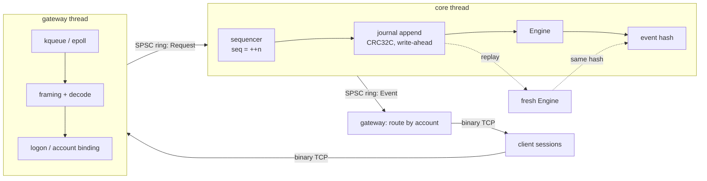
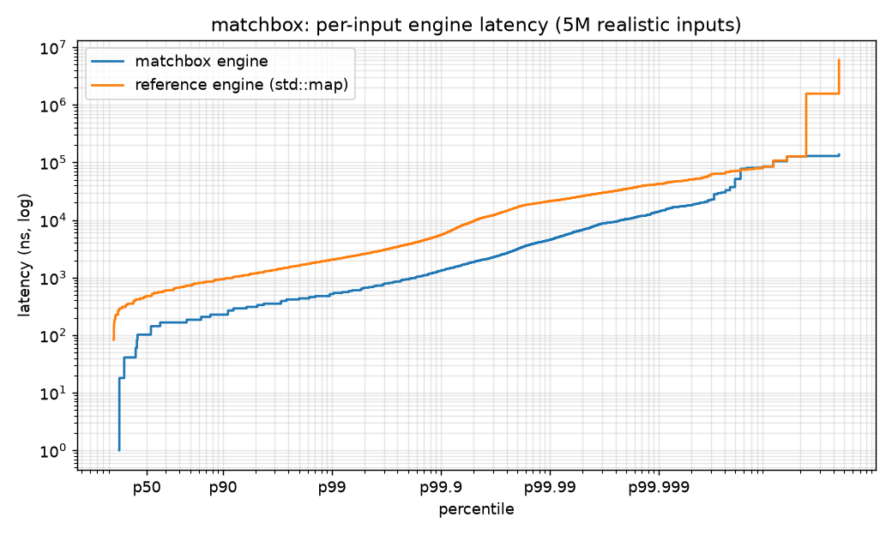

# matchbox

A price-time priority matching engine and exchange gateway in C++20. It supports limit, market,
IOC, FOK, post-only, iceberg and stop orders, cancel/replace with documented priority rules, and
self-trade prevention. A single-threaded sequencer journals every input before matching, so replay
is bit-identical. The engine is verified event-for-event against an independent reference
implementation.

[](https://github.com/eshaan2418/matchbox/actions/workflows/ci.yml)


> Educational/research project. Not investment advice. No live trading. Not a real exchange.

## Headline numbers

Apple M5 Pro laptop, Apple clang 21, `-O3 -mcpu=native`. Realistic generated order flow; medians
of 5 runs. Raw output in [`bench/results/20261102-003223/`](bench/results/20261102-003223/SUMMARY.md).

| metric | value |
|---|---|
| Engine throughput (5M inputs: limits, IOCs, cancels, replaces, icebergs, stops) | **12.4M inputs/s** (81 ns/input) |
| Same flow, `std::map`/`std::list` reference engine | 2.08M inputs/s (**5.9× slower**) |
| Per-input engine latency p50 / p99 / p99.9 | **125 / 541 / 1,333 ns** |
| Heap allocations after warm-up | **0** (reference: 3.86M) |
| Optimised vs reference engine, same 5M inputs | identical event-stream hash (11.09M events) |
| Order → ack over loopback TCP, 100k req/s, 8 sessions | p50 86 µs, p99 330 µs (shared, loaded laptop; see caveats) |
| Journal replay == live run | identical event hash in all 12 end-to-end runs |
| Durability cost: fsync per input / group commit per 64 | 40k inputs/s (24 µs p50) / 1.76M inputs/s |

## Demo

`make demo` starts the exchange with a write-ahead journal and drives it with the open-loop load
generator. It then stops the exchange, replays the journal, and shows that the live and replayed
event hashes match:


## Why it matters

The matching engine is the heart of an exchange: every order on a venue goes through it, and its
rules define the market. Each rule needs to be exactly right and stated in writing: who has
priority, what a replace does to queue position, how icebergs refill, what happens when a stop
cascade starts, how self-trades are prevented. The engine must also be **deterministic**, because
recovery, replication to hot standbys, market-data reconstruction and every regulatory dispute
depend on replaying the sequenced input log exactly. The same skills apply on the trading side:
the matching rules are what a backtester's fill model, or a market maker's queue-position model,
must reproduce.

## Highlights

- **Rules first, then two implementations.** [`docs/RULES.md`](docs/RULES.md) specifies every
  behaviour. A deliberately naive `ReferenceEngine` and the optimised `Engine` must produce
  byte-identical event streams. This is checked over 1.4M random inputs in the differential tests,
  by a libFuzzer harness over arbitrary input bytes, and on the 5M-input benchmark flow.
- **Invariants that don't trust either implementation.** RapidCheck checks fill pairing, no
  trade-through, makers trading at their own price, quantity conservation, an uncrossed book, and
  level aggregates equal to their queues.
- **Allocation-free hot path.** Index-linked order and level pools, the touch at `back()` of a
  sorted level array, open-addressing id map, sorted stop books, inlined event sink. A counting
  `operator new` shows 0 allocations after warm-up.
- **Deterministic sequencer + write-ahead journal.** One core thread assigns sequence numbers,
  CRC32C-journals and matches. Torn tails and corrupt records are detected on replay (tested), and
  replay reproduces the live event hash.
- **Real network path.** A kqueue/epoll gateway with a binary protocol, per-account event routing
  (makers receive their fills), and malformed-frame handling. An open-loop load generator measures
  from the *scheduled* send time, avoiding coordinated omission.

## Quick start

```bash
# macOS (brew install cmake ninja) or Linux (apt-get install cmake ninja-build clang)
make build test              # Release build + 38 tests (GoogleTest, RapidCheck, end-to-end TCP)
make demo                    # exchange + load generator + journal replay
make bench                   # full benchmark suite (~6 min, idle machine)
make sanitize tsan fuzz      # ASan/UBSan, TSan, libFuzzer (needs a clang with libFuzzer)

build/matchbox serve --port 9000 --journal /tmp/mb.journal --fsync-every 64
build/mbload --port 9000 --connections 8 --rate 100000 --duration 10
build/matchbox replay /tmp/mb.journal       # prints the same event hash as the live run
```

No external data is needed: order flow is generated deterministically (`include/matchbox/gen.hpp`).

## Architecture



**Data flow.** The gateway decodes a frame, stamps the session's account and pushes the request
onto the core ring. The core assigns the sequence number (a new order's id), appends the input to
the journal, and runs the engine. Every event goes to the outbound ring, and the gateway writes it
to the session of the event's account: the taker gets Accepted and its fills, and each maker gets
its own fill.

**Threading.** Two threads, both busy-polling by default. The rings provide back-pressure in both
directions, and the gateway drains events while waiting for request space, so they cannot
deadlock. Details: [`docs/DESIGN.md`](docs/DESIGN.md). Market mechanics:
[`docs/MICROSTRUCTURE.md`](docs/MICROSTRUCTURE.md).

## Correctness

| layer | what it checks |
|---|---|
| Rule tests (both engines) | price-time priority and maker price; IOC/market never rest; FOK all-or-none incl. limit and self-trade; post-only reject; iceberg refill losing priority and full-reserve sweeps; three STP modes; replace keeps priority only for same-price decreases and can trade on reprice; cancel/replace ownership; stop triggering and cascades; validation |
| Differential | 7 flow profiles, 1.4M inputs: every event byte-identical, book levels and queues identical |
| Property (RapidCheck) | fill pairs; no trade-through; makers at own price; conservation (filled + leaves = original, re-based on replace); cancels cancel exactly the leaves; book never crossed; aggregates = queues |
| Fuzzing (CI) | `fuzz_engine`: arbitrary bytes as inputs to both engines (abort on any difference); `fuzz_protocol`: framer/decoder bounds and re-encoding |
| Journal | CRC32C test vector; round trip; torn tail and corruption detection; replay determinism |
| End to end | two TCP clients trade; both receive fills; ownership rejects; malformed frame closes the session; journal replay hash == live hash |
| Allocation | 0 `operator new` calls over 1M inputs after warm-up |
| Sanitizers | ASan+UBSan and TSan run the full suite (incl. the threaded gateway test and SPSC stress) in CI |

## Performance

**Methodology.**
- Engine benchmarks pre-generate 5M realistic inputs and time the engine only. Latency mode
  timestamps each input with the architected counter (`ISB; MRS`, about 9 ns per read, 42 ns
  effective resolution on M5). The first 10% is warm-up.
- End-to-end runs use the real server and `mbload` over loopback: 8 sessions, open-loop schedule,
  latency from the scheduled send to the Accepted/Rejected event, 2 s warm-up, 10 s measured,
  3 runs per rate.

| in-process | inputs/s | ns/input |
|---|---|---|
| optimised engine | **12.36M** | 81 |
| + buffered write-ahead journal | 5.75M | 174 |
| + fsync every 64 (group commit) | 1.76M | 569 |
| + fsync every input | 0.04M | 24,680 |
| reference engine | 2.08M | 482 |

| per-input latency (ns) | p50 | p90 | p99 | p99.9 | p99.99 |
|---|---|---|---|---|---|
| optimised | 125 | 250 | 541 | 1,333 | 5,060 |
| reference | 417 | 875 | 1,958 | 4,792 | 18,032 |



| end-to-end, target req/s | achieved new-orders/s | p50 | p99 | p99.9 | unacked |
|---|---|---|---|---|---|
| 10k | 8.0k | 43 µs | 139 µs | 10.6 ms | 0 |
| 50k | 40.0k | 58 µs | 208 µs | 4.3 ms | 0 |
| 100k | 80.0k | 86 µs | 330 µs | 0.66 ms | 0 |
| 200k | 160k | 201 µs | 6.1 ms | 11.4 ms | 0 |

(20% of requests are cancels, which the load generator sends but does not time.)

**Caveats, stated plainly.**
- **Loaded machine.** The end-to-end runs shared the laptop with an unrelated heavy workload
  (load average 3-7, in `machine.txt`). Busy-polling threads that get descheduled produce the
  millisecond p99.9s, which are worst at low rates. The engine is under 1 µs of each round trip;
  the rest is the kernel TCP stack and four syscalls. A Linux box with isolated cores and pinned
  threads (or kernel bypass) is the real test.
- **Single symbol.** Throughput is per engine instance. Multiple instruments would shard engines
  across cores behind the sequencer or per-symbol sequencers.
- **macOS fsync** does not flush the drive cache (`F_FULLFSYNC` would), so the fsync numbers
  understate true power-loss durability cost.
- **Acks before durability.** Acks are sent when the engine emits them, which is correct for the
  no-fsync policy only. Holding acks until group commit completes is on the roadmap.

Optimisation notes and measurement lessons, including a benchmark sink whose hashing cost more
than matching: [`docs/PERF_LOG.md`](docs/PERF_LOG.md).

## Design decisions and trade-offs

| decision | chosen | rejected, and why |
|---|---|---|
| priority | price-time FIFO | pro-rata (futures-specific; different incentives) |
| iceberg refill | back of queue | keep priority (would let hidden size dominate the queue) |
| post-only on cross | reject | slide one tick (venue-specific; harder to reason about) |
| FOK + self-trade | FOK fails, no side effects | cancel makers then fail (surprising side effects) |
| stop trigger | last trade, evaluated after each input; deterministic order | BBO-based or mid-input triggers (order-dependent) |
| engine threading | single core thread, sequencer + journal + match | locks per book or lock-free book (nondeterminism, no throughput need) |
| book structure | sorted level array with the touch at back + index-linked pools | `std::map` levels (5.9× slower, allocations) |
| id lookup | open addressing (ids are sequential) | `unordered_map` (node allocation) |
| protocol | fixed-layout binary | FIX tag-value (parsing cost; FIX belongs in a gateway project) |
| durability | write-ahead journal with group-commit policy | per-input fsync by default (24 µs/input) |

## Limitations and roadmap

- Ack release after group commit, and a replicated journal with a hot standby. The Go
  fault-tolerant exchange cluster in this portfolio does Raft replication of the sequence.
- Market-data publisher (ITCH-like) driven from engine events, so that
  [itchbook](https://github.com/eshaan2418/itchbook) could consume it.
- Gateway pre-trade risk checks: price bands, position limits, message throttles, kill switch.
- Multi-symbol sharding. Thread pinning on Linux, with an io_uring or kernel-bypass gateway.
- Market-order price protection and volatility halts to break stop cascades.

## Related projects

- [itchbook](https://github.com/eshaan2418/itchbook): NASDAQ ITCH 5.0 feed handler (the other side
  of an exchange: consuming its market data).
- [marketmux](https://github.com/eshaan2418/marketmux): multi-venue crypto market-data platform.

## Project structure

```
include/matchbox/  types.hpp (inputs/events) engine.hpp reference_engine.hpp journal.hpp net.hpp
                   gen.hpp order_map.hpp spsc_ring.hpp latency.hpp
src/               journal (CRC32C), gateway/core server + protocol + poller, flow generator
tools/             matchbox (serve, replay), mbload (open-loop load generator)
tests/             rules, differential, property, journal, protocol, SPSC, end-to-end gateway, alloc
fuzz/              libFuzzer: engine differential, protocol
bench/             engine benchmark, suite scripts, raw results
docs/              RULES, DESIGN, MICROSTRUCTURE, PERF_LOG, DEEP_DIVE (interview Q&A)
```

## License

MIT. See [LICENSE](LICENSE). Educational/research project. Not investment advice. No live trading.
